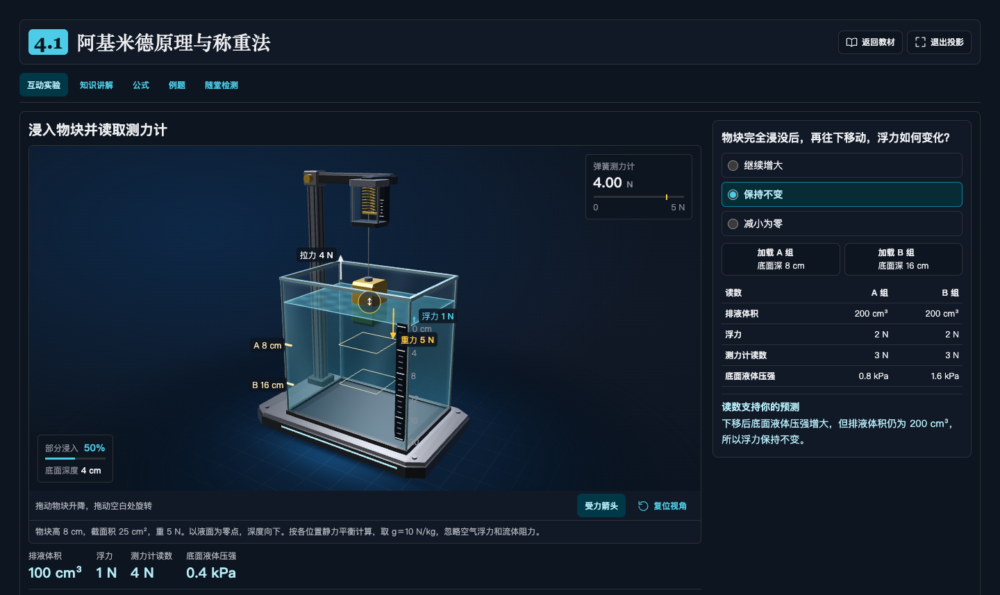

# Zhijing AI Course Studio

[简体中文](README.md) | [MIT License](LICENSE) | [Contributing](CONTRIBUTING.md)

Zhijing is an **offline-first course authoring studio for interactive textbooks, virtual physics labs, and classroom demonstrations**. Teachers can turn a curriculum outline into editable lessons with explanations, formulas, experiments, and practice questions. One structured lesson can be previewed in the editor, projected in class, and reused for independent study.



## Try it locally

**No installation:** Download or clone the repository and open [`web/index.html`](web/index.html) in a browser. This offline prototype includes sample lessons, basic simulations, and exercises. The interface and sample lessons are in Chinese.

**Full studio:** Install Git, Node.js 22.12+, and [uv](https://docs.astral.sh/uv/getting-started/installation/). uv prepares the required Python 3.11+ environment using the lockfile.

```bash
git clone https://github.com/ljx240/ai-course-studio.git
cd ai-course-studio
npm ci --ignore-scripts --no-audit --no-fund
```

Run `./run-studio.sh` on macOS or Linux, or `run-studio-windows.bat` in Windows cmd. Open [the local studio](http://127.0.0.1:8000/studio/). Initial dependency installation requires internet access. The 3D labs require WebGL.

## What you can do

- **Author from a syllabus.** Import a Markdown, plain text, DOCX, or text-based PDF outline. Edit and review lesson blocks, keep versions, and export Lesson JSON. PDF import requires Poppler `pdftotext`.
- **Teach with interactive models.** Change a quadratic function and see its graph update, or manipulate 3D physics apparatus in WebGL. The [Beijing middle-school physics sample course](docs/BEIJING-MIDDLE-PHYSICS.md) includes 19 lessons and 20 experiments with paired trials. Other subjects include math, chemistry, English, Chinese, history, and civics. There are also high-school physics examples.
- **Reuse lessons across teaching modes.** The editor, reader, lab, and classroom projector share content and experiment state. Students can take local notes, try exercises, and review their answers.
- **Connect a model when you need it.** An optional OpenAI-compatible Chat Completions endpoint supports draft generation and contextual tutoring. Lesson drafts use a validated schema and registered simulations. A teacher reviews drafts before publishing. Offline templates and scripted answers run without a model.

The full studio runs on one device with React, TypeScript, FastAPI, and SQLite. Model requests send the relevant lesson context to the configured endpoint; notes and exercise records stay in the browser. See the [Chinese README](README.md#可选的-ai-模型) for model configuration and storage details.

## Develop and contribute

The [Lesson DSL](docs/LESSON-DSL.md) defines portable lessons, the [Subject Pack SDK](docs/SUBJECT-SDK.md) registers interactive scenes, and the [renderer](packages/lesson-renderer) presents the same lesson across teaching modes. See the [architecture](docs/ARCHITECTURE.md), [feature status](docs/FEATURE-MATRIX.md), and [contribution guide](CONTRIBUTING.md) for the implementation and checks.

Original project code, documentation, and sample assets are available under the [MIT License](LICENSE). Dependencies and cited material retain their own terms; see [licenses and sources](docs/LICENSES-AND-SOURCES.md).
