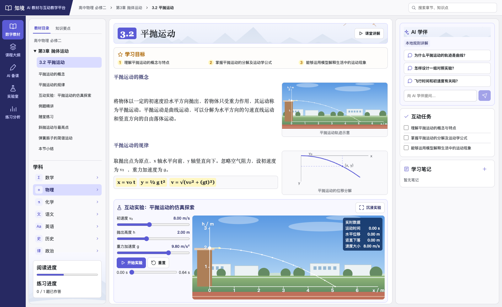
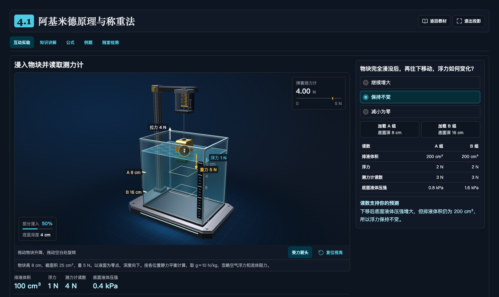

# 知境 AI Course Studio

[English](README.en.md) | [MIT 许可证](LICENSE) | [贡献指南](CONTRIBUTING.md)

知境是一个面向教师和教研团队的**互动教材创作与课堂演示工具**。导入教学大纲，按章节制作教材，把公式、分步例题、可操作实验和练习编排成一节课。同一份教材可以用于备课预览、课堂投影和学生自主学习，阅读器与实验室共享实验参数。

教材采用可编辑、可导出的 Lesson DSL。内置教材和实验可离线使用；配置兼容模型服务后，也可以从大纲生成草稿，由教师复核后发布。

Open-source course authoring studio for **interactive textbooks, virtual physics labs, and optional AI lesson authoring**.



## 快速体验

**直接体验**：下载仓库后，用浏览器打开 [`web/index.html`](web/index.html)。Windows 也可双击 `run-windows.bat`。这是零依赖的离线版，含内置教材和基础实验，无需安装 Node.js、Python 或配置模型。

**启动完整工程版**：安装 Git、Node.js 22.12+ 和 [uv](https://docs.astral.sh/uv/getting-started/installation/)。uv 会按锁文件准备所需的 Python 3.11+ 环境。

```bash
git clone https://github.com/ljx240/ai-course-studio.git
cd ai-course-studio
npm ci --ignore-scripts --no-audit --no-fund
```

macOS / Linux：

```bash
./run-studio.sh
```

Windows cmd：

```bat
run-studio-windows.bat
```

打开 [本机工程版](http://127.0.0.1:8000/studio/)。首次安装依赖需要联网；启动后，浏览内置教材、操作实验和完成练习不需要模型服务。3D 实验需要浏览器支持 WebGL。

## 用它做什么

| 场景 | 可以完成的工作 |
| --- | --- |
| 从大纲备课 | 导入 Markdown、纯文本、DOCX 标题或带文字层的 PDF，整理目录后选课，创建草稿。PDF 导入需要 PATH 中的 Poppler `pdftotext`。 |
| 创作互动教材 | 编辑段落、公式、例题、实验和练习，实时预览、保存版本、导出 Lesson JSON。可复制离线模板，也可从大纲生成一节、整章或整册草稿。 |
| 演示数学和物理 | 拖动二次函数参数观察图像变化；在原生 WebGL 中操作电路、透镜、浮力与运动装置，观察读数并记录对照。 |
| 课堂讲解和自主学习 | 按教材步骤讲解、全屏投影、使用设备语音朗读；学生可操作实验、记笔记和答题。练习反馈来自当前浏览器的作答记录。 |
| 复用和扩展课程 | 同一份 Lesson JSON 由阅读器、创作台和课堂使用；新增学科互动可通过 Subject Pack 注册场景和参数。 |

### 内置课程：北京初中物理专题提升

工程版内置 **19 课时、20 项初中物理实验**，涵盖电学、力学、浮力、热学、光学和电磁等专题。启动后打开[浮力课](http://127.0.0.1:8000/studio/#/reader/physics/physics-bj-4-1)，点击「互动演示」，拖动物块，观察浸没深度、浮力与测力计示数，并比较 A/B 两组条件。

工程版另外提供数学、高中物理和化学、英语、语文、历史、政治示例，共覆盖七个学科。[查看物理课程目录和授课指南](docs/BEIJING-MIDDLE-PHYSICS.md) | [浏览实际运行截图](design/工程化运行截图)



## 可选的 AI 模型

在工程版右上角打开「AI 服务设置」，填写服务地址、模型 ID 和所需密钥，测试连接后保存。支持 OpenAI 兼容的 Chat Completions 服务，例如 OpenAI、NewAPI 网关或本机 Ollama（可用 `http://127.0.0.1:11434/v1`，不启用密钥）。服务端接受 HTTPS 和本机 HTTP。也可在启动前设置 `ZJ_LLM_BASE_URL`、`ZJ_LLM_MODEL`、`ZJ_LLM_API_KEY` 和 `ZJ_LLM_TIMEOUT`。

- **制作教材**：模型生成结构化草稿，后端校验内容结构、场景和参数；事实、公式和来源由教师复核。整册任务在本机后台运行，关掉浏览器后仍可继续，重启服务后可恢复。
- **课堂学伴**：可根据当前教材和实验状态回答问题。界面区分不同来源的内容；离线模板和本地规则回复不调用模型。
- **模型数据**：启用相关功能后，请求会把所需的大纲、教材或实验状态发送到配置的模型端点；学伴还会发送提问与当前面板最近三轮对话。页面保存的密钥由服务端以明文保存在本机 `studio.ai-provider.sqlite3`，不会回显到页面。

本项目面向单机备课、演示和学习。FastAPI 绑定本机，大纲、版本与任务存放在 SQLite（默认 `data/studio.sqlite3`，可通过 `ZJ_STUDIO_DB` 调整）。笔记和作答存放在当前浏览器。课程示例供教学参考，由教师按使用场景复核。

## 开发与验证

运行 `npm run dev` 可使用 Vite 开发前端，API 请求会代理到本机 8000 端口。构建后也可以用 `npm run preview` 预览静态工程版。

```bash
npm run typecheck
npm run build
npm run test:models
node --experimental-strip-types --test tests/test_formula.mjs
uv run --locked python -m unittest discover -s tests -p test_backend.py -v
```

浏览器验收使用临时 SQLite 和本机模型协议夹具，无需真实模型密钥。完整命令和截图选项见[贡献指南](CONTRIBUTING.md)。

| 模块 | 职责 |
| --- | --- |
| [`apps/studio`](apps/studio) | React / TypeScript / Vite 工程入口 |
| [`packages`](packages) | Lesson Schema、教材渲染、学科 SDK、课堂动作和设计系统 |
| [`api`](api) | FastAPI、Pydantic 校验、SQLite 持久化和模型适配 |
| [`content`](content) | 示范课程、导入样例与 JSON Schema |
| [`web`](web) | 零依赖离线原型和本地素材 |
| [`tests`](tests) | 后端、科学计算和浏览器验收 |

[架构](docs/ARCHITECTURE.md) | [功能状态](docs/FEATURE-MATRIX.md) | [Lesson DSL](docs/LESSON-DSL.md) | [Subject Pack SDK](docs/SUBJECT-SDK.md) | [API](docs/API.md)

## 许可与贡献

项目的原创代码、文档和示范资源采用 [MIT 许可证](LICENSE)。第三方依赖及引用资料继续适用各自的许可，详见[素材来源与版权说明](docs/LICENSES-AND-SOURCES.md)。欢迎提交可复现的问题、教学勘误或新的互动课程，见[贡献指南](CONTRIBUTING.md)。
