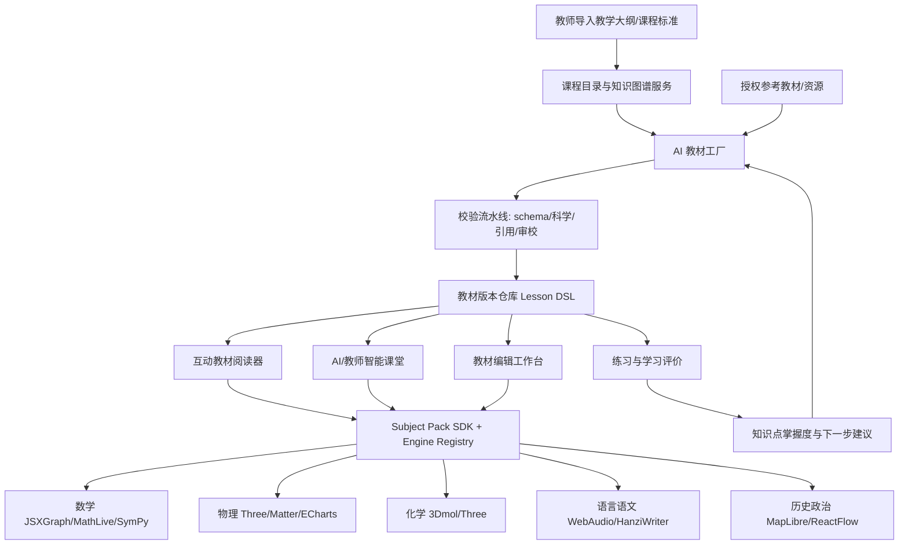

# 技术架构与方案设计

## A. 设计原则

1. **教材为中心**：教材是一份结构化文档，播放器、创作台和实验室都是对同一份 Lesson DSL 的不同呈现。
2. **大纲为索引**：学科/书册/章节/小节/知识点属于课程目录，课程标准独立建模，由 KnowledgePoint 与 StandardRequirement 关联。
3. **学科专属插件**：学科自己提供交互引擎、教学模板、视觉主题和验证器；平台只定义生命周期与 UI 容器。
4. **AI 只做受控编排**：生成 JSON、选择已注册场景、配置参数与受控讲解动作；不让模型直接执行任意代码。
5. **离线优先**：已发布课件可离线阅读、实验与练习；AI 连接是增强功能，不是教学必需条件。
6. **可审核可复现**：同一版本的教材、组件版本和实验参数应支持可复现的教学结果。

## B. 总体架构



## C. 单机版技术栈

| 层 | 选择 | 用途 |
|---|---|---|
| Web 应用 | React + TypeScript + Vite | 组件生态、复杂状态管理、可维护性 |
| UI / 设计系统 | CSS Tokens 与 Radix 色阶 | 统一基础组件，保持学科可变样式 |
| 内容编辑器 | React 结构化表单 | 教材块编辑与实时预览 |
| 状态与工作流 | React 与共享场景实例 | 教材、实验和课堂共享状态 |
| 服务端 | FastAPI + Pydantic | AI 工作流、DSL 校验、实时服务 |
| 主数据 | SQLite 与浏览器本地存储 | 课程、版本、整册任务及个人学习记录 |
| 教学资源 | 本地静态资源 | 课件图像和互动模型 |
| 长任务 | SQLite 持久队列与本机工作线程 | 整册教材生成和进程重启恢复 |
| 模型接入 | 统一 OpenAI-compatible Adapter | 多厂商切换，控制服务端 Key |
| 导出 | Lesson JSON | 教材快照和批量草稿 |

> 单机工程版已采用 React、TypeScript、Vite 与 FastAPI。部署现状见 J 节，`web/` 保留零依赖入口。

## D. 模块职责拆分参考

```text
apps/
  teacher-web/                  教师门户、大纲与教材创作
  learner-web/                  阅读与自主学习
  classroom-web/                投屏、授课调度与课堂互动
  api/                          统一入口及身份权限
packages/
  design-system/                Tokens / typography / primitives
  curriculum-core/             课程大纲树、标准映射
  lesson-schema/               Lesson DSL / JSON Schema / version migration
  lesson-renderer/             文本/公式/交互/练习块渲染
  subject-sdk/                 引擎生命周期、动作协议、事件总线
  subject-packs/
    math/ physics/ chemistry/ english/ chinese/ history/ politics/
  classroom-runtime/           时间轴、演示状态、AI受控动作
  assessment-core/             作答、判分、知识点分析
services/
  syllabus-parser/             PDF/DOCX/Markdown 文档解析
  lesson-generator/            章节规划、教材块编排、模型调用
  content-validator/           结构、学科计算、引用、风险审核
  asset-pipeline/              多媒体生成、转码、缓存
  tutor-orchestrator/          AI讲解和场景控制
```

## E. 运行时数据流

1. 大纲节点选中：前端保留 `curriculumNodeId` 和 `lessonVersionId`，向内容服务查询已发布教材版本。
2. 加载教材：对 Lesson JSON 做 Schema 校验，按 block.type 渲染；interactive 块匹配 `subjectPack.engine` 和 templateId。
3. 操作实验：交互引擎接收 `setParameters`，确定性计算状态，发出 `{sceneId, state, timestamp}`，更新讲解与练习上下文。
4. AI 提问：携带章节 ID、当前教材块摘要、允许的场景状态（无隐私）请求 tutor；返回可显示文字或受控 action list，前端再授权执行。
5. 教学记录：交互操作、问答、练习结果的事件写入会话；成绩分析使用有来源、明确计算规则的数据。

## F. 教材生命周期

```
Draft → GeneratedDraft → TeacherReviewed → SubjectReviewed → Approved → Published
                          └→ Rejected/NeedsRevision
Published → Deprecated（保留历史版本，不直接覆盖已发布快照）
```

基于哈希/版本号固定教材的 blocks + engine version + 教师审核记录；课堂启动引用确定版本。

## G. 课程大纲与教材实体

- `Curriculum`：课程体系、地区/学段/课程标准版本。
- `CurriculumNode`：任意层级大纲节点，父子关系、顺序、节点类型、学习目标。
- `StandardRequirement`：课程标准要求，原始来源、适用地区及时间。
- `KnowledgePoint`：稳定知识点，前置关系与课程标准映射。
- `Lesson`：逻辑课程身份，可关联多个节点/知识点。
- `LessonVersion`：不可变教材版本（JSON DSL 与审核信息）。
- `SubjectPack`：学科包版本和能力清单。
- `Asset`：课程资源及版权/来源信息。
- `AssessmentItem/Attempt`：题库与作答。
- `LearningSession/Event`：教学会话、交互事件和演示记录。

## H. 教材操作协议示例

```json
{
  "actionId": "act-0001",
  "type": "setParameters",
  "engine": "physics.projectile2d",
  "sceneId": "lesson-3.2-lab",
  "payload": {"speed": 8.0, "height": 2.0, "gravity": 9.8},
  "requiresConfirmation": false
}
```

允许动作注册表：`setParameters`、`play`、`pause`、`reset`、`seek`、`highlight`、`showFormula`、`compareRuns`、`askQuestion`。危险操作（删除课程、发布版本、外部分享）必须由有权限教师主动确认。

## I. 部署与安全

- 单机运行：FastAPI 绑定本机并提供构建后的 Web，SQLite 保存本机课程数据，模型密钥由服务端统一处理。
- 离线运行：`web/index.html` 可打开内置教材、实验和练习，并复制模板开始编辑。模型功能使用本机后端配置的 Provider。
- 教材发布通过人工复核，模型提供的实验配置使用已注册引擎。界面按文本渲染模型内容。

## J. 已交付的单机工程版

```text
apps/studio                  React 单应用，五个主页面和课堂讲解
packages/design-system       Radix 色阶与通用控件
packages/lesson-schema       由 Pydantic Schema 驱动的浏览器结构校验
packages/lesson-renderer     文档、块、图形和可操作场景
packages/subject-sdk         受信任场景、参数范围、确定性模型和共享状态
packages/classroom-runtime   受控课堂动作的客户端执行
api/                         模型适配、生成任务、上下文辅导及事务存储
web/                         V0.2 离线入口与复用素材
```

FastAPI 提供 `/studio/` 工程版与 `/` 原生版。工程版通过 URL 片段路由切换页面，静态构建和 API 共用本机来源。教材浏览、实验和个人练习在模型关闭时可用。服务端保存大纲及不可变教材快照，浏览器存储个人学习记录和最近工作区。

AI 服务设置保存在工作区数据库旁的独立 SQLite 文件。配置接口仅接收本机来源，响应返回密钥配置状态。生成和学伴通过同一个 Chat Completions 适配器读取启用的配置。单节生成任务使用同一配置完成规划和内容生成。

大纲修订和新教材快照可以在同一 SQLite 事务提交。每学科以 revision 做并发检查。发布记录引用固定版本，后续草稿继续使用新快照。课程标准与知识点映射独立存储。发布人为教师填写的审校记录。

整册任务记录课程树、生成参数、预期修订号和每节草稿。独立的 SQLite 锁文件允许每个数据文件只有一个执行器，服务退出时释放锁。重启后从任务记录恢复。每节结果复用现有模型流水线与校验。提交目录链接和草稿时使用同一个事务，遇到修订冲突时保留生成结果。

场景的 DOM 渲染与交互状态分开。Lesson ID、块 ID、引擎和初始参数共同定位场景。教材、实验室和课堂共用实例。参数契约存于 `content/schemas/scenes.json`。模型输出仅能引用当前教材的块、注册场景和允许的动作。
